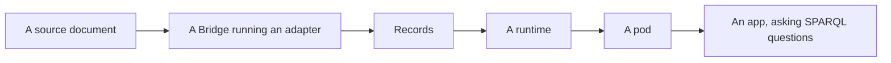

# Cascade Protocol

**An open standard for health apps that put patients in control of their own data.**

Each person's records live in their own pod: a single-tenant RDF graph, kept as Turtle files. Records arrive from each source format through a **Cascade Bridge** running an **adapter**, so every app reads the same records and asks them the same standard SPARQL questions. Pods can be encrypted, though the format is still being hardened after an outside review and is not yet claimed to be safe ([#733](https://github.com/jayostis/cascade-runtime-js/issues/733), [#321](https://github.com/jayostis/cascade-runtime-js/issues/321)). It is built on RDF/Turtle, SPARQL 1.1, SHACL, RO-Crate and EARL.

> **Status: draft.** The Bridge's namespace is `v1-draft` and the vocabulary is a draft, and no compatibility is promised before a numbered v1. No claim is made that anything here is fit for clinical use. None of the current repositories is published to npm yet ([jayostis/cascade-runtime-js#310](https://github.com/jayostis/cascade-runtime-js/issues/310)): an app is made from a build on a GitHub release, and the rest is used from a clone.

## Start here

**Build an app.** [Try a pod in your browser](https://jayostis.github.io/cascade-starter-kit/try/), then follow the [quick start](https://jayostis.github.io/cascade-runtime-js/start.html): one command makes an app from [cascade-starter-kit](https://github.com/jayostis/cascade-starter-kit), and a coding agent builds your idea on it. The [API](https://jayostis.github.io/cascade-runtime-js/api/) is on the hub too.

**See a pod from the inside.** Open [Alex Rivera's pod](https://jayostis.github.io/cascade-runtime-js/alex-rivera/) in the pod explorer: its files, how they are laid out and how a view is built. The hub lists [all four example pods](https://jayostis.github.io/cascade-runtime-js/examples.html).

**Write an adapter for a new source format.** Start at [cascade-bridge-spec/adapter](https://github.com/jayostis/cascade-bridge-spec/tree/main/adapter).

**Write a runtime, or a Bridge in another language.** Start at [cascade-vocabulary/runtime](https://github.com/jayostis/cascade-vocabulary/tree/main/runtime) for a runtime, or [cascade-bridge-spec/engine](https://github.com/jayostis/cascade-bridge-spec/tree/main/engine) for a Bridge.

Not sure where to go? [The Cascade hub](https://jayostis.github.io/cascade-runtime-js/) says where to find each thing.

## How it fits together

## Repositories

### Contract: what everything is checked against

| Repository | What it is |
|---|---|
| [cascade-vocabulary](https://github.com/jayostis/cascade-vocabulary) | The contract a pod is built and read by: ontologies and SHACL shapes, the standard SPARQL queries, the runtime rules as Gherkin feature files, and the conformance kits. |
| [cascade-bridge-spec](https://github.com/jayostis/cascade-bridge-spec) | The Cascade Bridge Specification: the contract every adapter and every Bridge follows, and the tooling that tests them against each other. |

### Engine

| Repository | What it is |
|---|---|
| [cascade-bridge-rs](https://github.com/jayostis/cascade-bridge-rs) | The Cascade Bridge in Rust, also built for WebAssembly. It runs an adapter and its test manifest. It is the only engine that runs adapters today. |

### Adapters: data, no code

| Repository | What it is |
|---|---|
| [cascade-bridge-adapter-fhir-r4](https://github.com/jayostis/cascade-bridge-adapter-fhir-r4) | FHIR R4 JSON into Cascade records. |
| [cascade-bridge-adapter-ccda](https://github.com/jayostis/cascade-bridge-adapter-ccda) | C-CDA R2.1 XML, as a patient portal hands it out, into Cascade records. |

### Data

| Repository | What it is |
|---|---|
| [cascade-reference-tables](https://github.com/jayostis/cascade-reference-tables) | Reference tables kept current from open publishers: the contract a table builder follows, the builders, and the feed apps read. ([Its site](https://jayostis.github.io/cascade-reference-tables/).) |

### Runtime and apps

| Repository | What it is |
|---|---|
| [cascade-runtime-js](https://github.com/jayostis/cascade-runtime-js) | The reference runtime, in TypeScript. It files what arrives into a pod and answers questions from it, in Node or entirely in a browser. It proves itself against the vocabulary's conformance kits. |
| [cascade-starter-kit](https://github.com/jayostis/cascade-starter-kit) | The app a person starts from on the runtime: the template, the same app in a browser, and the command that makes one. |
| [cascade-sandbox](https://github.com/jayostis/cascade-sandbox) | A pretend health system with a past: demo FHIR hospitals that answer as of a date, for testing patient-facing apps. |

## Conformance

Conformance is executable:

- A runtime runs every example of the vocabulary's feature files and its conformance kits, and reports each one in EARL. The [latest result](https://jayostis.github.io/cascade-runtime-js/conformance/) is on the hub.
- A Bridge runs every adapter's test manifest.
- The vocabulary, the runtime, the Bridge and each adapter has a `compatibility.json` naming what it must pass with.

Pull requests that change two repositories land as a pair, linked by `Depends-On:` lines ([compatibility.md](https://github.com/jayostis/cascade-bridge-spec/blob/main/compatibility.md)).

## Contributing

- **[All open issues](https://github.com/search?q=repo%3Ajayostis%2Fcascade-vocabulary+repo%3Ajayostis%2Fcascade-bridge-spec+repo%3Ajayostis%2Fcascade-bridge-rs+repo%3Ajayostis%2Fcascade-bridge-adapter-fhir-r4+repo%3Ajayostis%2Fcascade-bridge-adapter-ccda+repo%3Ajayostis%2Fcascade-reference-tables+repo%3Ajayostis%2Fcascade-runtime-js+repo%3Ajayostis%2Fcascade-starter-kit+repo%3Ajayostis%2Fcascade-sandbox+is%3Aissue+is%3Aopen&type=issues)** and **[good first issues](https://github.com/search?q=repo%3Ajayostis%2Fcascade-vocabulary+repo%3Ajayostis%2Fcascade-bridge-spec+repo%3Ajayostis%2Fcascade-bridge-rs+repo%3Ajayostis%2Fcascade-bridge-adapter-fhir-r4+repo%3Ajayostis%2Fcascade-bridge-adapter-ccda+repo%3Ajayostis%2Fcascade-reference-tables+repo%3Ajayostis%2Fcascade-runtime-js+repo%3Ajayostis%2Fcascade-starter-kit+repo%3Ajayostis%2Fcascade-sandbox+is%3Aissue+is%3Aopen+label%3A%22good+first+issue%22&type=issues)**.
- A term, a rule or a query is changed in **cascade-vocabulary**, with a decision note in `decisions/`.
- A new source format is a new **adapter** repository: data only, checked by the Bridge specification's tests.
- Every repository has a `CONTRIBUTING.md` in its root that says how to set it up, run its checks and open a pull request, for example [cascade-vocabulary's](https://github.com/jayostis/cascade-vocabulary/blob/main/CONTRIBUTING.md) and [cascade-runtime-js's](https://github.com/jayostis/cascade-runtime-js/blob/main/CONTRIBUTING.md).
- Each repository's `CLAUDE.md` carries its rules, for a person and for a coding agent alike.
- Never include real patient data in an issue, a pull request or a fixture.
- Please follow the [code of conduct](https://github.com/the-cascade-protocol/.github/blob/main/CODE_OF_CONDUCT.md). To report a vulnerability, read the [security policy](https://github.com/the-cascade-protocol/.github/blob/main/SECURITY.md).

## Namespaces

Terms have IRIs under `https://ns.cascadeprotocol.org/`: the vocabulary's under `cascade#`, the Bridge's under `bridge/v1-draft#`. These draft namespaces are not served yet; read the terms in [cascade-vocabulary's ontologies](https://github.com/jayostis/cascade-vocabulary/tree/main/ontologies) and [cascade-bridge-spec's vocab](https://github.com/jayostis/cascade-bridge-spec/tree/main/vocab).

## Deprecated

These were the protocol's first prototypes. They are no longer developed and are kept for reference.

| Repository | Was | Replaced by |
|---|---|---|
| [spec](https://github.com/the-cascade-protocol/spec) | Ontologies, shapes, serialization and pod specifications | cascade-vocabulary and cascade-bridge-spec |
| [conformance](https://github.com/the-cascade-protocol/conformance) | Conformance fixtures and a reference patient pod | cascade-vocabulary's conformance kits |
| [cascade-cli](https://github.com/the-cascade-protocol/cascade-cli) | A command-line tool for pods, `@the-cascade-protocol/cli` | cascade-runtime-js and cascade-starter-kit |
| [sdk-typescript](https://github.com/the-cascade-protocol/sdk-typescript) | A TypeScript SDK, `@the-cascade-protocol/sdk` | cascade-runtime-js |
| [sdk-python](https://github.com/the-cascade-protocol/sdk-python) | A Python SDK, `cascade-protocol` on PyPI | none yet |
| [cascade-agent](https://github.com/the-cascade-protocol/cascade-agent) | A natural-language interface to the old CLI, `@the-cascade-protocol/agent` | the chat and MCP add-ons of cascade-starter-kit |

## Licence and trademarks

Code is under the [Apache License 2.0](https://www.apache.org/licenses/LICENSE-2.0). Vocabulary terms copied from `spec` remain [CC BY 4.0](https://creativecommons.org/licenses/by/4.0/). Each repository's `LICENSE` governs it.

"Cascade Protocol" and its logo are trademarks of Cascade Agentic Labs LLC. The licences cover the code and the specifications, not the name or logo. See the [trademark policy](https://cascadeprotocol.org/legal/trademarks.html).
